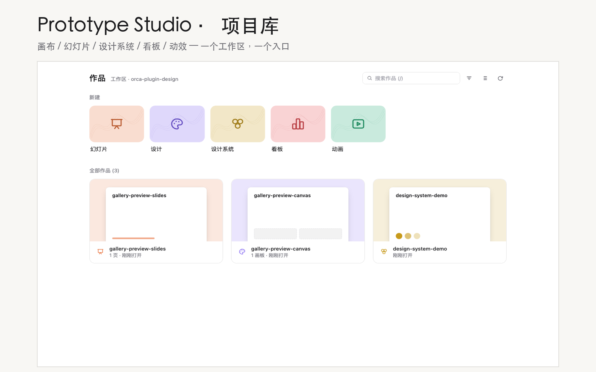
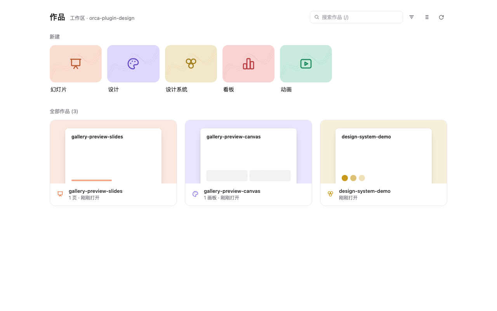
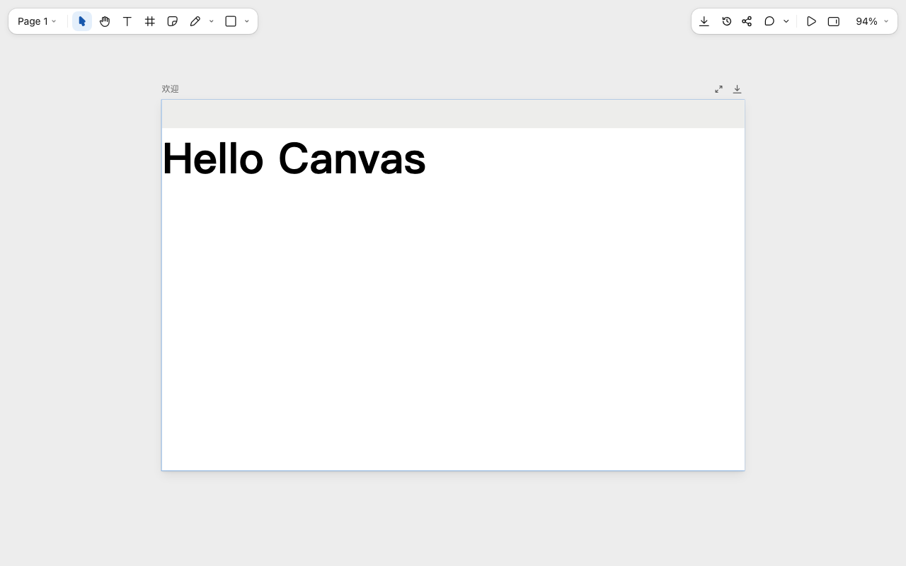

# Lakala-Design-Plugin



把 Anthropic 风格的设计工具链带进 Orca 工作区：**幻灯片、设计、设计系统、看板、动效**五类作品，状态栏一个图标（或 `Mod+Alt+P`）打开项目库，库内创建、打开、重命名、删除，编辑器在同一 Tab 内跳转。

| 项目库 | 画布编辑器 |
| :---: | :---: |
|  |  |

## 快速开始

1. 在 Orca 中打开任意本机工作区。
2. 点状态栏 **Design**（图标 `layers`），或按 `Mod+Alt+P`。
3. 库页顶部选类型 → 创建作品 → 卡片「打开编辑」。

作品默认写到 `<工作区>/.design/<名称>/`，随仓库一起版本管理。

## 五类作品

| 类型 | 入口命令 | 识别文件 | 编辑内容 |
| --- | --- | --- | --- |
| 🎬 幻灯片 | `prototype.skill.claude-slides` | `project/deck.json` | 逐页 HTML，可演示，导出 PDF/HTML/PPTX |
| 🎨 设计 | `prototype.skill.claude-design` | `project/canvas.json` | 无限画布 + 多个画板 |
| 🧩 设计系统 | `prototype.skill.claude-design-system` | `project/design-system.json` | tokens、字体、组件预览、资产组、品牌书 |
| 📊 看板 | `prototype.skill.claude-dashboard` | `db/dash/meta.json` | 指标、图表、数据源面板 |
| ▶️ 动效 | `prototype.skill.claude-motion` | `db/film/meta.json` | 逐场景代码动画，导出 MP4/GIF |

编辑器由 vendored 的 [baoyu-design](https://github.com/JimLiu/baoyu-design) 提供。工作区里只要存在上表的识别文件，库页就会扫描到该作品（最深 3 层）。

## 使用

- **状态栏入口**：`Design`，点击后在当前工作区右侧打开库页 Tab；已存在则直接切换。
- **快捷键**：`Mod+Alt+P`（仅在 `workspace` 上下文生效）。
- **命令面板**：`Open Design Gallery` 及五个 `Open … Editor` 命令，可绕过库页直开编辑器。
- **库页操作**：置顶、搜索、类型筛选、网格/列表切换、时间线历史、重命名、删除、恢复。
- **同一 Tab 内跳转**：卡片「打开编辑」进入编辑器，顶部返回条回到库。
- **新建文件**：文件树新建 `.proto.html` 时使用 `templates/starter.proto.html` 起手模板。

## 安装

要求 Orca ≥ 1.4.248。

### 通过 catalog（推荐，可自动更新）

本仓库根目录提供 [`orca-catalog.json`](orca-catalog.json)，条目以 git 源安装，按 `releases[].commit` 拉取精确版本（最新为 0.2.0）：

```bash
cat orca-catalog.json   # 交给 Orca 的 catalog URL / 社区目录收录
```

或直接把插件仓库作为 Git 源安装。任选其一，均会解析到 0.2.0：

```text
https://github.com/hubo1989/orca-plugin-design.git
https://github.com/hubo1989/orca-plugin-design.git#main
https://github.com/hubo1989/orca-plugin-design.git#v0.2.0
```

CLI 等价写法：

```bash
orca plugin install 'https://github.com/hubo1989/orca-plugin-design.git' --json
orca plugin install 'https://github.com/hubo1989/orca-plugin-design.git#v0.2.0' --json
```

> `#ref` 只接受真实存在的 branch / tag / 完整 40 位 commit SHA。本项目 tag 带 `v` 前缀（例如 `v0.2.0`）；填写 `#0.2.0`、未创建的 tag 或拼错分支会触发 `plugin_not_found`，UI 显示为「无法获取此 Git 版本。请检查 URL、#ref 和访问权限」。不带 `#ref` 时 Orca 优先选择最新 `vX.Y.Z` tag，否则回退默认分支。首次安装会停在 `approval_required`，这是权限确认，不是 Git fetch 失败。

### 从本地文件夹安装

```bash
git clone https://github.com/hubo1989/orca-plugin-design
cd orca-plugin-design
bash bin/package.sh --full        # 组装 ../prototype-studio-dist（lite/full 均含 assets、vendored 技能与缩略图工具）
# Orca → Settings → Plugins → Install from folder → 选择 ../prototype-studio-dist
```

> 从文件夹安装的是 `local-path` 源，不会自动检查更新；新版本需要重新执行 `git pull && bin/package.sh --full` 并重装一次。

### 更新

catalog / git 源安装的副本由 Orca 按 `releases[]` 检查更新：新条目置顶后即可更新（策略 `auto` 默认开启，`manual` 时在插件设置里手动点）。**能力增长会重新征求同意**，仅版本变化不会。

## 数据落在哪

| 内容 | 位置 |
| --- | --- |
| 作品本体 | `<工作区>/.design/<名称>/`（含 `project/`、`history/`） |
| 删除的作品 | 应用数据目录 `baoyu-design/trash/`，库页可恢复 |
| 缩略图缓存 | 应用数据目录 `baoyu-design/thumbs/` |
| 项目库服务 | `127.0.0.1:3480`，独立进程，worker 被回收后库页仍可用 |

「应用数据目录」在 macOS 为 `~/Library/Application Support/orca/baoyu-design`，Windows 为 `%APPDATA%\orca\baoyu-design`，Linux 为 `~/.config/orca/baoyu-design`；可用 `ORCA_DESIGN_HOME` 覆盖。

## 设计要点

- **项目库（Gallery）**：独立本地 HTTP 服务聚合当前工作区的作品，支持置顶、搜索、筛选、时间线历史；worker 被回收后库页依然存活。
- **工作区感知**：精确解析焦点工作区（Orca profile 的 `activeWorktreeId`）；远程/本机不可见的工作区明确拒绝，不在本机创建影子目录。
- **点击体验**：状态栏即时显示「⟳ 打开中…」，已有 Tab 直接切换，库页内置加载骨架屏与服务冷启动自动重试。
- **主题跟随宿主**：读取 Orca `settings.theme` 首帧注入；`system` 时跟随浏览器 `prefers-color-scheme`，也支持 `?scheme=dark|light` 覆盖。
- **本地接口收口**：状态变更只接受同源 `application/json` POST（`src/post-guard.mjs`），GET 无法拉起编辑器或删除作品；请求体上限 64 KiB。
- **权限最小化**：只申请 `workspace:read` 与 `agent:read`；主题读取走 profile，不申请 `appearance:write`。

## 开发

```bash
npm test                        # node --test 'test/*.mjs'
node test/smoke-gallery.mjs     # 冒烟：mock host 激活 worker + 真实 CLI 开库页
bash bin/package.sh --full      # 组装并 validate/inspect dist
orca plugin dev watch .         # 开发模式加载 + 热重载
orca plugin release-entry . --json   # 生成 catalog 的 releases 条目（HEAD 的 commit + contentHash）
```

### 目录结构

```text
orca-plugin.json          manifest（命令 / 状态栏 / 快捷键 / 事件 / 新建文件）
src/worker.js             trusted worker：命令与面板处理器、工作区解析、服务生命周期、Tab 切换
src/gallery-server.mjs    项目库单文件 HTTP 服务（含内嵌前端与 API）
src/post-guard.mjs        POST 收口：方法 / content-type / 同源 / 大小
src/skills-meta.mjs       五类技能元数据、示例模板、slides 向导提示词
src/examples.json         官方示例清单
tools/thumb.mjs           缩略图生成（headless Chrome）
tools/layout-check.mjs    版式校验
vendor/baoyu-design/      原样 vendor 的编辑器与技能指令，见 NOTICE.md
assets/                   icon / cover / screenshots（参与 contentHash）
references/               版式、排版、演示、QA 清单
templates/                .proto.html 起手模板
test/                     HTTP / API / POST 收口 / vendor 改写 / 冒烟
```

所有命令与面板处理器统一经 `reg()/handle()` 包装：异常一律转 `{ok:false,error}`，不会把 rejection 冒泡成宿主「运行失败」弹窗。

### 测试用环境变量

| 变量 | 作用 |
| --- | --- |
| `ORCA_STATE_FILE` | 覆盖状态文件路径（测试隔离） |
| `ORCA_PROFILE_DB` | 覆盖 Orca profile SQLite 路径 |
| `ORCA_DESIGN_HOME` | 覆盖应用数据目录（trash / thumbs） |
| `ORCA_CLI_COMMAND` | 覆盖 `orca` CLI 可执行文件（smoke 用 mock） |
| `PORT` | 覆盖项目库端口，默认 3480 |

## 故障排查

| 现象 | 处理 |
| --- | --- |
| 点状态栏没反应或显示「运行失败」 | 打开 Orca → 插件日志看 worker 是否激活；`orca plugin list --json` 确认已启用且版本正确 |
| 库页空白 / 一直转圈 | `curl -sS http://127.0.0.1:3480/api/list` 直连服务；无响应说明服务未起，点一次入口会重新拉起 |
| 远程工作区点入口报「仅支持本机工作区」 | 预期行为：库页与编辑器都跑在 Orca 宿主机，看不到远程盘时明确拒绝，避免写影子目录 |
| 装完发现是旧版本 | catalog 源的 `releases[].commit` 决定字节；确认条目已置顶，必要时 `orca plugin install <url>#<tag>` 重装 |
| Git 安装提示「无法获取此 Git 版本」 | 检查 `#ref` 是否为真实 branch / tag / 40 位 SHA（本项目 tag 带 `v` 前缀），以及仓库访问权限 |

## 发布

发布流程（改代码 → C1 → `release-entry` → catalog C2 → tag）见 [CATALOG.md](CATALOG.md)；每个版本的真机实测纪要见 [docs/field-notes.md](docs/field-notes.md)。

## 许可证

Mixed. 插件自身代码 MIT；`vendor/baoyu-design/` 内含 Anthropic 派生的技能指令与编辑器资产，归 Anthropic 所有，不随 MIT 发布。详见 `LICENSE` 与 `NOTICE.md`。
