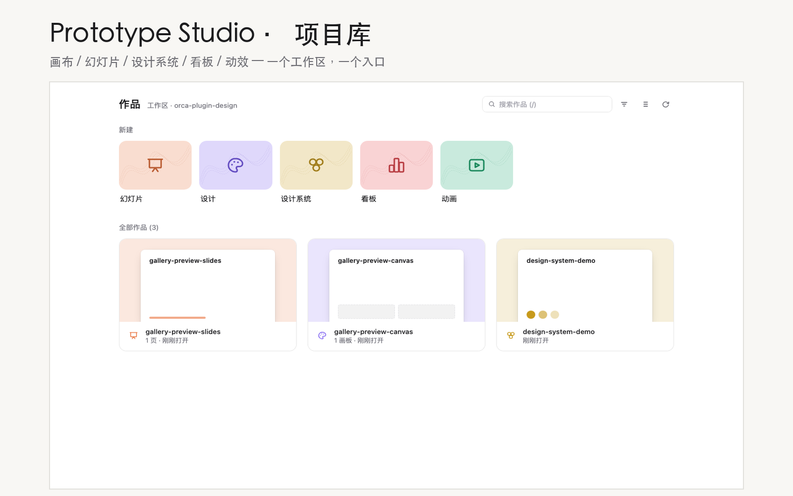
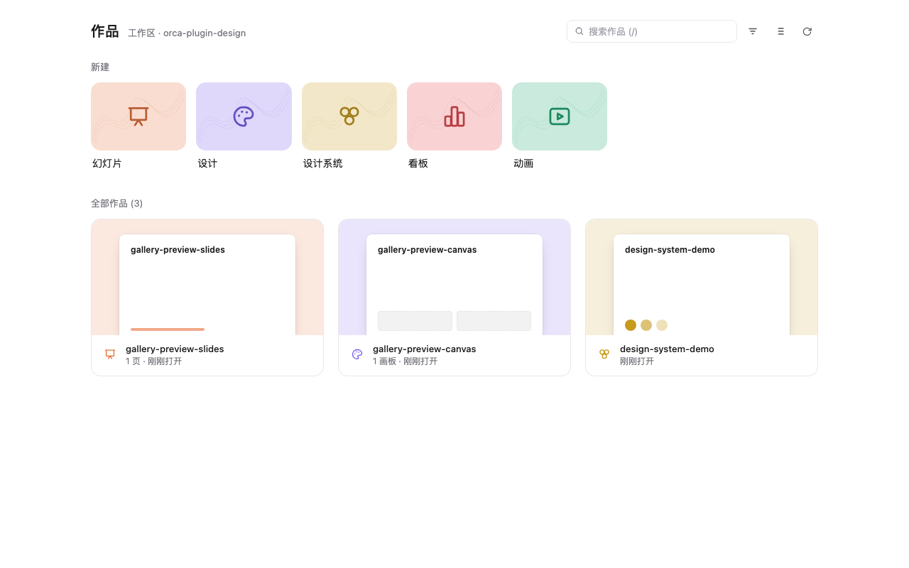
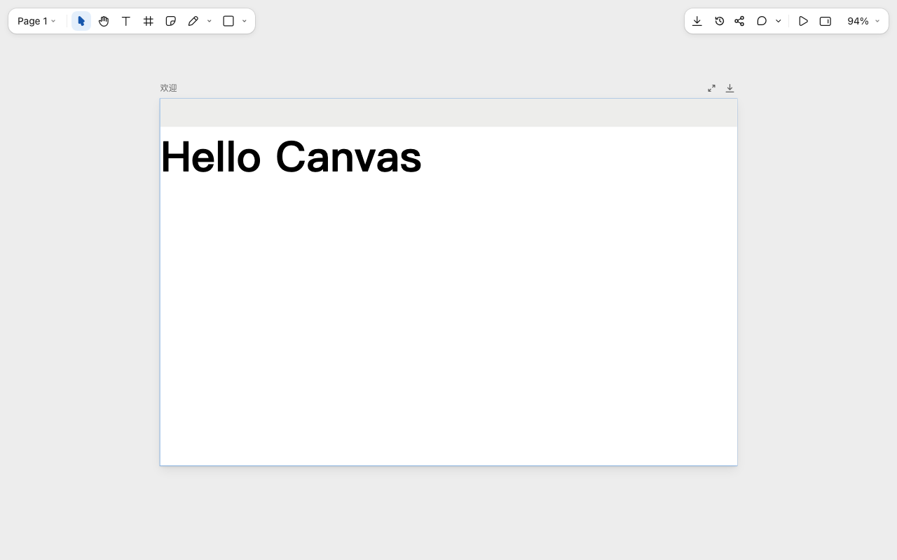
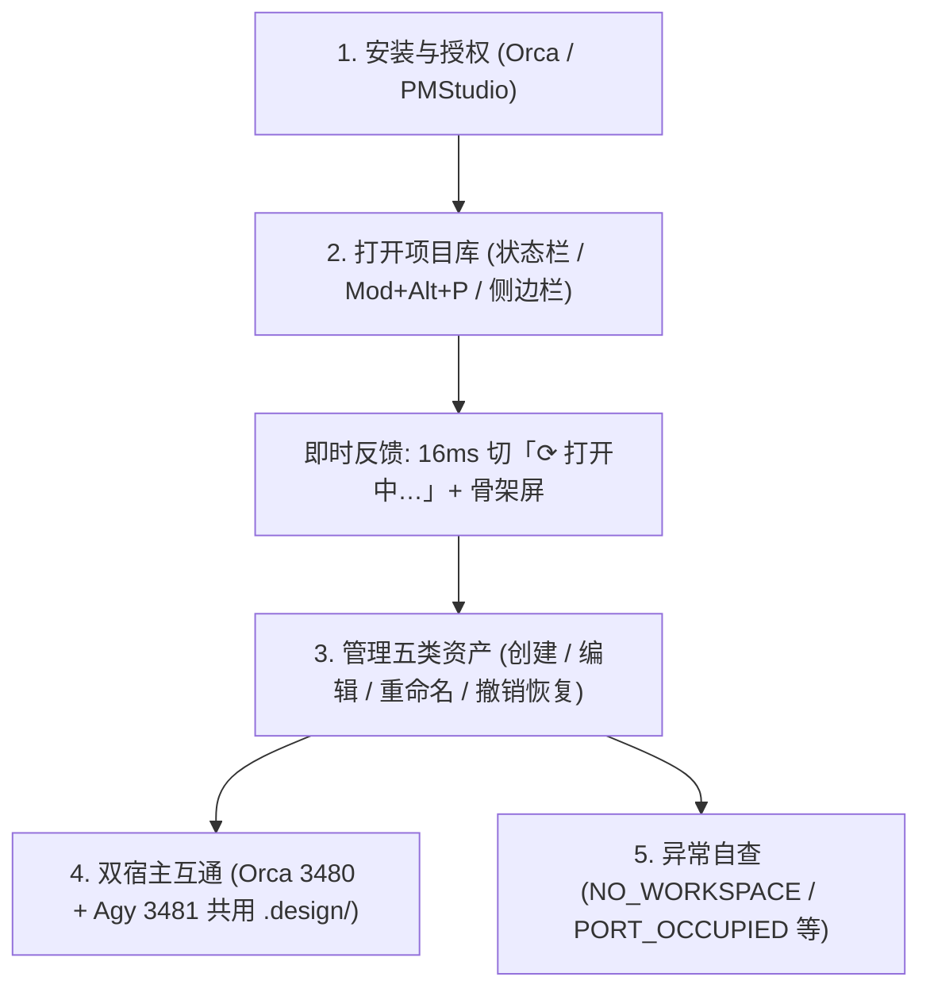

# Lakala-Design-Plugin



把 Anthropic 风格的设计工具链带进 Orca 与 LKL-PMStudio 工作区：**幻灯片、设计、设计系统、看板、动效**五类设计资产全流程闭环管理。状态栏一个图标（或 `Mod+Alt+P`，PMStudio 左侧边栏一键触达）即可秒级拉起项目库，库内直接创建、打开编辑、同步重命名、安全删除与 10 秒撤销恢复，编辑器在同 Tab 内无缝切换。

| 项目库（Gallery） | 画布编辑器（Canvas Editor） |
| :---: | :---: |
|  |  |

---

## 核心特性与支持环境

- **当前版本**：`v0.2.1`（分支基线：`lkl`）
- **支持宿主**：
  - **Orca**：版本要求 `≥ 1.4.274`（支持底部状态栏、快捷键、命令面板）
  - **LKL-PMStudio**：支持左侧主活动栏（Primary Sidebar）原生 `Design` 页面直达
- **即时反馈与性能 SLA**：
  - **即时反馈**：点击入口 `<= 16ms` 内状态机切换为「`⟳ 打开中…`」，首帧拉起 `#opening` 骨架屏；
  - **启动耗时**：热启动端到端 `< 100ms`（实测 ~66ms），冷启动端到端 `< 1.0s`（实测 ~345ms）；
  - **防连点防抖**：500ms 内连续点击仅触发 1 次，成功打开后 2 秒防抖，发生错误 `0ms` 立即复位允许重试；
  - **硬超时保护**：`8.0s` 准时硬超时收口（`START_TIMEOUT`），自动清理挂起子进程并呈现降级卡片。
- **双宿主共存互通**：
  - Orca（`127.0.0.1:3480`）与 Agy（`127.0.0.1:3481`）端口独立、平滑共存；
  - 双方共用 `<工作区>/.design/` 设计资产目录无缝接续协作，应用数据目录与回收站完全隔离。
- **安全与工作区护栏**：
  - HTTP 四重安全校验（仅监听本地回环、写端点仅允许同源 `application/json` POST、请求体上限 64 KiB）；
  - 真实路径防软链逃逸校验与三道防误写护栏（禁止误写系统根路径、家目录、`.ssh` 或插件安装目录，零 `process.cwd()` 回退）。

---

## 非开发者分步操作指南

本指南面向非开发者用户，每一步均明确写出**在哪个应用/界面操作**、**怎么打开**、**需要复制粘贴的命令（如有）**、**预期看到什么界面**以及**看到什么算成功**。



---

### 第一步：插件安装、权限确认与版本核对

#### 方式 A：通过 Git 源在 Orca 界面中安装（推荐）

1. **在哪个应用/界面操作**：Orca 桌面客户端主窗口。
2. **怎么打开**：
   - 打开 Orca 应用；
   - 点击左下角齿轮图标 **设置（Settings）**，在弹出菜单中点击 **插件（Plugins）**。
3. **操作步骤与输入**：
   - 在插件界面的「添加 Git 插件源（Install from Git）」输入框中粘贴以下完整 Git 地址：
     ```text
     https://github.com/hubo1989/orca-plugin-design.git#v0.2.1
     ```
   - 点击输入框右侧的 **Install（安装）** 按钮。
   - *（命令行备用方式）*：若习惯在终端中执行，复制粘贴以下命令并回车：
     ```bash
     orca plugin install 'https://github.com/hubo1989/orca-plugin-design.git#v0.2.1' --json
     ```
4. **首次权限弹窗确认（Approval Required）**：
   - **预期界面**：Orca 会弹出权限授权确认弹窗（标题为 `Approval Required` 或 `需要插件权限`），提示该插件申请了以下两项必要权限：
     - `workspace:read`：读取当前工作区内的设计作品目录；
     - `agent:read`：读取助手会话状态以便在动效/看板中引导提示词。
   - **如何操作**：直接点击弹窗中的 **批准（Approve）** 或 **允许** 按钮。
   > **说明**：停留在 `approval_required` 是 Orca 的安全机制，属于正常的权限确认环节，绝非安装失败。
5. **看到什么算成功**：
   - 插件列表出现 `Lakala-Design-Plugin` 条目；
   - 状态为已启用（开关为蓝色开启状态）；
   - 版本号明确显示为 **`0.2.1`**。

#### 方式 B：本地文件夹离线打包与安装

1. **在哪个应用/界面操作**：系统终端（Terminal）与 Orca 客户端。
2. **怎么打开**：打开系统终端应用，进入本仓库所在目录：
   ```bash
   cd orca-plugin-design
   ```
3. **需要复制粘贴的命令**：
   ```bash
   bash bin/package.sh --full
   ```
4. **预期看到什么输出**：
   终端输出显示打包产物已成功生成在 `../prototype-studio-dist`，末尾输出验证通过日志：
   ```text
   runtime files: OK
   valid: true
   ```
5. **在 Orca 中加载并确认成功**：
   - 打开 Orca → 设置（Settings）→ 插件（Plugins）；
   - 点击 **从文件夹安装（Install from folder）** 按钮；
   - 在弹出的文件选择器中选中刚生成的 `../prototype-studio-dist` 目录；
   - 看到提示「安装成功」，列表中版本显示为 **`0.2.1`** 即代表成功。

---

### 第二步：打开项目库（Orca 与 LKL-PMStudio 双端入口）

在打开设计项目库前，请确保 Orca 或 PMStudio 中**已经打开了任意一个本地项目文件夹**（菜单：文件 → 打开文件夹）。

```
+---------------------------------------------------------------------------------------+
| Orca 编辑器工作区                                                                      |
|                                                                                       |
|   [文件树]      [代码编辑区 / 画布展示区]                                                 |
|                                                                                       |
|                                                                                       |
|---------------------------------------------------------------------------------------|
| 底部状态栏:  ...  UTF-8   Git: main   [ layers  Design ] <-- 点击此处 (或按 Mod+Alt+P)  |
+---------------------------------------------------------------------------------------+
```

#### 1. 在 Orca 中打开

- **在哪个应用/界面操作**：Orca 编辑器工作区窗口。
- **怎么打开**：
  - **方法一（推荐）**：鼠标点击窗口右下角底部状态栏上的 **`Design`**（带图层 `layers` 图标）；
  - **方法二（快捷键）**：直接按下快捷键 **`Mod+Alt+P`**（macOS 为 `Cmd + Option + P`，Windows/Linux 为 `Ctrl + Alt + P`）；
  - **方法三（命令面板）**：按下 `Cmd+Shift+P`（或 `Ctrl+Shift+P`）打开命令面板，输入 `Open Design Gallery` 并回车。
- **预期看到什么界面（关键状态变化）**：
  1. **点击即刻反馈（<= 16ms）**：点击瞬间，状态栏上的 `Design` 文字会立即变为「**`⟳ 打开中…`**」，直观表明系统已受理请求，无需重复连击；
  2. **骨架屏快速呈现**：在编辑器右侧新建标签页并迅速呈现 `#opening` 骨架屏动画卡片，杜绝白屏等待；
  3. **防连点与防抖**：500ms 内即使不小心连击多次，系统自动识别并仅执行 1 次；在成功打开后 2 秒内再次点击会自动激活已有标签页，不重复弹窗；
- **看到什么算成功**：
  - 标签页标题显示为 **`Design Gallery`**（设计项目库）；
  - 顶部显示作品分类选项卡（全部、幻灯片、设计、设计系统、看板、动效）；
  - 底部状态栏文字自动复位为 **`Design`**。

#### 2. 在 LKL-PMStudio 中打开

- **在哪个应用/界面操作**：LKL-PMStudio 桌面客户端。
- **怎么打开**：在窗口最左侧的主活动栏（Primary Sidebar）中，直接点击 **`Design`** 图标。
- **看到什么算成功**：主内容区直接加载原生 `gallery-page.html` 设计项目库界面，完整呈现五类资产视图。

---

### 第三步：五类设计资产全流程闭环操作

项目库中的所有作品默认均保存在当前工作区的 **`<工作区>/.design/<作品名称>/`** 目录下，随 Git 仓库一起提交管理。

#### 五类作品规格速查表

| 类型 | 界面标识 | 识别核心文件 | 内容与应用场景 | 创建与使用规则 |
| :--- | :--- | :--- | :--- | :--- |
| **🎬 幻灯片** | `Claude Slides` | `project/deck.json` | 逐页 HTML 演示文稿，支持全屏演示、导出 PDF/PPTX/HTML | 库页直接创建，同 Tab 内可视化逐页编辑 |
| **🎨 设计** | `Claude Design` | `project/canvas.json` | 无限画布 + 多个画板，适合 UI/原型/视觉稿设计 | 库页直接创建，同 Tab 内拖拽式画布编辑 |
| **🧩 设计系统** | `Design System` | `project/design-system.json` | 品牌标准、设计规范、全局 Tokens、组件库预览 | **单工作区全局唯一**（重复创建提示已存在） |
| **📊 看板** | `Claude Dashboard` | `db/dash/meta.json` | 业务看板、指标卡、多图表联动与数据分析面板 | **非静态类型**：引导 Agent 提示词生成数据结构 |
| **▶️ 动效** | `Claude Motion` | `db/film/meta.json` | 基于代码的逐场景动画，可导出 MP4/GIF | **非静态类型**：引导 Agent 提示词生成脚本 |

---

#### 核心操作详细步骤

##### 1. 创建新作品（含单例与同名自增规则）
- **在哪个应用/界面操作**：已打开的 Design Gallery（设计项目库）页面顶部操作栏。
- **怎么操作**：
  1. 在顶部类型下拉框中选择要创建的作品类型（如「幻灯片」或「设计」）；
  2. 在名称输入框中输入作品名称（例如 `产品规划演示`）；
  3. 点击右侧的 **创建（Create）** 按钮。
- **预期看到什么输出/界面**：
  - 作品列表中立即出现新作品卡片；
  - 磁盘在 `<工作区>/.design/产品规划演示/` 下自动初始化对应骨架文件（如 `project/deck.json`）。
- **特殊规则**：
  - **同名自增保护**：若已存在名为 `产品规划演示` 的作品，再次创建同名作品时，系统会自动命名为 `产品规划演示-2`、`产品规划演示-3`，绝不会覆盖已有文件。
  - **设计系统全局唯一**：当前工作区若已存在一个设计系统，再次尝试创建会弹出提示 `当前工作区已存在设计系统，请直接编辑已有设计系统 (DESIGN_SYSTEM_EXISTS)`，引导直接打开既有设计系统。
  - **看板与动效 Agent 引导**：若在快速新建弹窗中点击「看板」或「动效」，界面会弹出专属引导面板，提供 **「发送给 Agent 对话」** 与 **「复制 Agent 提示词」** 按钮。点击后自动拉起本地 AI 对话并带入结构化提示词；若 Agent 会话未就绪，系统会自动将提示词复制到系统剪贴板并弹出 Toast 提示。

##### 2. 打开编辑（同 Tab 内无缝切换）
- **怎么操作**：在任意作品卡片上，点击卡片中间的 **打开编辑（Open Editor）** 按钮。
- **预期看到什么界面**：
  - 当前标签页立即无缝跳转进入对应编辑器（无需弹出新的桌面窗口）；
  - 顶部出现固定的导航返回条（显示 `← 返回项目库` 及当前作品标题）。
- **看到什么算成功**：成功看到幻灯片页面列表或无限设计画布，可直接拖拽编辑；点击顶部 `← 返回项目库` 能够随时安全返回项目库主页。

##### 3. 重命名作品（物理目录与 JSON 标题双向同步）
- **怎么操作**：
  1. 在作品卡片右上角点击菜单图标 `···`，选择 **重命名（Rename）**；
  2. 在弹出的重命名对话框中输入新标题（例如 `2026产品规划正式版`）；
  3. 点击 **确认（Confirm）**。
- **预期看到什么输出/界面**：卡片标题立即刷新为 `2026产品规划正式版`。
- **看到什么算成功**：
  - 磁盘上的物理文件夹由 `<工作区>/.design/产品规划演示/` 自动重命名为 `<工作区>/.design/2026产品规划正式版/`；
  - 对应识别文件（如 `project/deck.json`）内的 `"title"` 字段同步更新为 `"2026产品规划正式版"`；双向同步无漂移。

##### 4. 删除作品与 10 秒撤销恢复
- **怎么操作**：在作品卡片右上角点击菜单图标 `···`，选择 **删除（Delete）**。
- **预期看到什么界面与看到什么算成功**：
  - **情况一：纯设计文件目录（标准设计作品）**
    - 作品卡片从当前列表中移出；
    - 文件夹被原子级移入应用数据目录的回收站（`baoyu-design/trash/`），**不污染工作区 Git 仓库**；
    - 屏幕右下角立即弹出 Toast 提示条：`已移入回收站 [撤销]`（倒计时 10 秒）；
    - **撤销恢复**：在 10 秒内点击 Toast 上的 **撤销（Undo）** 按钮，该作品将完好无损地复原至原目录，并立即重新展示在设计列表中。
  - **情况二：混合业务文件目录（目录下存在普通代码或文档）**
    - 系统会弹出风险保护提示：`检测到非设计文件，仅从设计库中移除，不会删除磁盘实际文件`；
    - 点击确认后，系统仅将该目录从设计库索引中剔除，并记录到本地应用数据目录的 `dismissed/` 清单中；
    - 磁盘上的原始业务文件完好无损保留，后续刷新列表也不会再次误扫描复活。

---

### 第四步：与 agy-plugin-design 双宿主共存与互通

本插件（Orca 侧）与 Agy 侧设计插件（`agy-plugin-design`）采用对称架构设计，支持在同一台机器上并存运行、无冲突互通。

```
                     ┌────────────────────────────────────────────────────────┐
                     │                  本机工作区 (Local Repo)                │
                     │                 <工作区根目录>/.design/                  │
                     └───────────────────────┬────────────────────────────────┘
                                             │ 共享读写作品资产
                     ┌───────────────────────┴────────────────────────────────┐
                     │                                                        │
          ┌──────────▼──────────┐                                  ┌──────────▼──────────┐
          │   Orca 宿主环境      │                                  │    Agy 宿主环境      │
          ├─────────────────────┤                                  ├─────────────────────┤
          │ 服务端口: 3480      │                                  │ 服务端口: 3481      │
          │ 应用数据:            │                                  │ 应用数据:            │
          │ <ORCA_DESIGN_HOME>/ │                                  │ <AGY_DESIGN_HOME>/  │
          │   ├─ trash/ (隔离)  │                                  │   ├─ trash/ (隔离)  │
          │   └─ thumbs/        │                                  │   └─ thumbs/        │
          └─────────────────────┘                                  └─────────────────────┘
```

1. **端口隔离与独立进程**：
   - **Orca 项目库服务**：默认监听在 **`127.0.0.1:3480`**；
   - **Agy 项目库服务**：默认监听在 **`127.0.0.1:3481`**；
   - 两者端口互不冲突，可在同一台电脑上同时启动运行，互不干扰。
2. **共享工作区设计资产（无缝接续协作）**：
   - 双宿主共同读写当前工作区根目录下的 **`<工作区>/.design/`** 目录；
   - **接续编辑场景**：在 Orca 中创建并编辑的幻灯片或设计稿，切换到 Agy 中打开相同工作区时，Agy 项目库能够实时扫描呈现并直接打开编辑；反之，在 Agy 中保存的改动，Orca 刷新后立即可见。
3. **应用数据与回收站对称隔离**：
   - 宿主私有数据（如作品回收站 `trash/`、忽略清单 `dismissed/`、缩略图缓存 `thumbs/`）分别保存在各自独立的宿主应用数据目录下（Orca 使用 `ORCA_DESIGN_HOME`，Agy 使用 `AGY_DESIGN_HOME`）；
   - 在 Orca 中将作品移入回收站不会影响 Agy 的回收站，也不会在工作区目录下产生临时垃圾文件。
4. **编辑器进程生命周期管理**：
   - 打开已有作品时，若检测到该作品对应的编辑器已在运行，会自动复用已有窗口（`reused: true`），避免重复打开占用内存；
   - 当关闭 Orca 插件服务（或退出 Orca）时，系统仅会安全关闭由 Orca 启动的编辑器子进程，**绝不会误杀由 Agy 启动的编辑器或 Agy 自身的后台服务**。

---

### 第五步：常见问题、异常错误码与一键自验自查手册

#### 1. 结构化异常错误码排查速查表

| 错误码 / 提示信息 | 出现原因 | 解决方案与操作步骤 |
| :--- | :--- | :--- |
| **`NO_WORKSPACE`**<br>（未打开本机工作区） | 当前 Orca 处于空窗口状态，未打开任何本地文件夹。 | **怎么做**：在 Orca 菜单栏点击 **文件（File）** → **打开文件夹（Open Folder）**，选择任意一个本地工程目录打开。 |
| **`REMOTE_OR_UNMOUNTED`**<br>（仅支持本机工作区） | 当前工作区为未挂载的远程路径、SSH 远程开发连接或容器环境。 | **怎么做**：由于插件和设计编辑器直接在宿主机本地读写文件，暂不支持未挂载的远程环境。请将项目代码通过 Git 克隆到本机磁盘后再打开。 |
| **`FORBIDDEN_WORKSPACE_PATH`**<br>（受保护路径拦截） | 当前打开的目录为系统根路径（`/`）、家目录（`~`）、系统敏感目录（`/System`、`~/.ssh`）或插件安装目录自身。 | **怎么做**：三道工作区写护栏已强制阻断误操作。请将普通项目放置在用户工作目录（如 `~/Projects/my-app`）中打开使用。 |
| **`PORT_OCCUPIED_BY_OTHER`**<br>（3480 端口被外部程序占用） | 本机 `3480` 端口被非 Orca 插件程序占用（插件通过 `/api/health` 智能识别，绝不强杀外部程序）。 | **怎么做**：<br>1. 打开终端运行 `lsof -i :3480` 查看占用进程并关闭；<br>2. 或在启动 Orca 前指定备用端口：`PORT=3485 orca`。 |
| **`START_TIMEOUT`**<br>（服务启动超时） | 后台服务拉起超过 8.0 秒硬超时门限（已准时清理挂起子进程并呈现降级卡）。 | **怎么做**：通常由于系统瞬间负载过高导致。点击页面中的 **重试（Retry）** 按钮即可重新拉起。 |
| **`DESIGN_SYSTEM_EXISTS`**<br>（设计系统已存在） | 当前工作区已存在一份设计系统，再次点击创建。 | **怎么做**：单工作区只允许存在一份全局规范。直接在卡片列表中点击已有设计系统的「打开编辑」即可。 |

---

#### 2. 非开发者一键自验标准（看到什么算成功）

按照以下四项逐一检查，全部符合即代表插件环境完全健康：

1. **入口点击即时反馈**：点击底部状态栏 `Design`，**1 秒内**（实测 `< 16ms`）状态栏文字立即变为「`⟳ 打开中…`」；
2. **骨架屏与页面加载**：页面在 **1 秒内**呈现并展开 `Design Gallery`，能看清作品卡片与顶部类型筛选按钮；
3. **状态栏复位**：页面加载完成后，底部状态栏文字自动变回正常的「`Design`」；
4. **同 Tab 编辑进出顺畅**：点击卡片「打开编辑」能顺利进入编辑器；点击顶部「← 返回项目库」能平滑返回，无错误弹窗。

---

#### 3. 命令行一键自验脚本（适用于终端诊断）

打开系统终端，复制粘贴执行以下诊断命令：

```bash
# 1. 检查 Orca 项目库服务健康状态
curl -sS http://127.0.0.1:3480/api/health
# 预期输出 JSON 包含: {"ok":true,"plugin":"orca-plugin-design",...}

# 2. 检查当前工作区作品列表与工作区路径
curl -sS http://127.0.0.1:3480/api/list
# 预期输出 JSON 包含: {"ok":true,"workspace":...,"artifacts":[...]}

# 3. 运行本地自动化冒烟测试（开发或深度验收）
cd orca-plugin-design
npm run smoke
# 预期输出显示:
# PASS: 命令正常 resolve，无 ReferenceError
# PASS: 2 秒连点节流生效
```

---

## 数据落在哪

| 数据内容 | 磁盘存储位置 | 说明 |
| :--- | :--- | :--- |
| **作品本体** | `<工作区根目录>/.design/<作品名称>/` | 包含 `project/`、`history/` 等，随 Git 版本库管理 |
| **删除的作品** | 应用数据目录 `baoyu-design/trash/` | 原子移入本地回收站，不污染 Git 工作区，支持 10 秒撤销 |
| **混合目录忽略清单** | 应用数据目录 `baoyu-design/dismissed/` | 仅剔除设计索引，保留磁盘业务代码且扫盘不复活 |
| **缩略图缓存** | 应用数据目录 `baoyu-design/thumbs/` | 页面卡片预览缓存 |
| **项目库后台服务** | 绑定 `127.0.0.1:3480`（支持 `PORT` 覆盖） | 独立于前端渲染进程，生命周期平滑接续 |

> **「应用数据目录」在各操作系统的默认路径**：
> - **macOS**：`~/Library/Application Support/orca/baoyu-design`
> - **Windows**：`%APPDATA%\orca\baoyu-design`
> - **Linux**：`~/.config/orca/baoyu-design`
> - *可通过系统环境变量 `ORCA_DESIGN_HOME` 统一覆盖自定义路径。*

---

## 架构与安全防护设计

- **本地接口收口**：状态变更只接受同源 `application/json` POST（`src/post-guard.mjs`），写端点禁止 `GET` 访问，跨站 `Origin` 或畸形请求统一返回 `403` / `415`，请求体严格限制 `64 KiB` 上限；
- **路径防穿越与防逃逸**：所有作品路径与回收站操作均严格执行 `resolveRealPath` 校验，拦截 `../`、外指软链逃逸及中间层符号链接攻击；
- **三道工作区写护栏**：禁止写入非本机/远程工作区、禁止写入受保护的系统根路径与家目录、禁止写入插件安装目录本身，未识别到有效工作区时绝不回退至 `process.cwd()`；
- **智能占口探测**：新增 `GET /api/health` 身份端点识别，遇到外部第三方占用端口时返回 `PORT_OCCUPIED_BY_OTHER` 并给出改端口建议，坚决不强杀外部应用进程；
- **双端资产互通与隔离**：工作区 `.design/` 作为共享契约，应用数据目录与编辑器进程生命周期严格隔离，双端协作互不干扰。

---

## 开发者与测试指南

```bash
# 运行全量自动化单元与集成测试（50 项断言）
npm test

# 运行交互冒烟基准（即时反馈与 2s 防抖）
npm run smoke

# 校验三方 Baoyu-Design Vendor 完整性（154 项文件零漂移）
npm run vendor:check

# 同步前端页面单文件资源
npm run sync:page

# 组装完整离线安装包并执行双目标插件校验
npm run package:full
```

### 仓库主要目录结构

```text
orca-plugin.json          插件清单配置（命令、状态栏、快捷键、事件通知与新建模板）
src/worker.js             核心 trusted worker（命令派发、工作区解析、生命周期、SLA即时反馈）
src/gallery-server.mjs    项目库单文件 HTTP 服务（含内嵌前端、API路由、回收站管理）
src/gallery-page.html     LKL-PMStudio 原生侧边栏直接加载的前端页面
src/post-guard.mjs        POST 请求安全网关（请求方法、类型、同源、报文大小防护）
src/skills-meta.mjs       五类设计资产元数据、创建模板与向导提示词
tools/vendor-baoyu.mjs    Vendor 技能代码与编辑器资产完整性校验工具
vendor/baoyu-design/      原样引入的编辑器与技能指令代码（详见 NOTICE.md）
assets/                   图标（icon）、封面（cover）与演示截图资源
test/                     全量自动化测试套件（HTTP安全、SLA冒烟、五类资产、双宿主隔离）
```

---

## 许可证（License & Notices）

本项目采用 Mixed 组合许可证：
- 插件自身代码、单文件桥接器、界面组件与测试套件均采用 **MIT 许可证**，详见 [LICENSE](LICENSE)；
- `vendor/baoyu-design/` 目录中所包含的由 Anthropic 派生的设计技能指令与画布编辑器资产，其知识产权归 Anthropic 所有，不随 MIT 发布，详见 [NOTICE.md](NOTICE.md) 与 `vendor/baoyu-design/NOTICE.md`。
